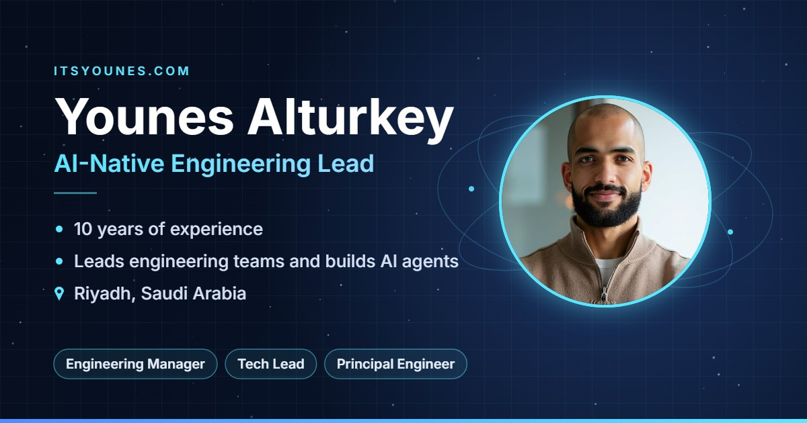

  

<h1 align="center">Younes Alturkey</h1>

  <b>AI-Native Engineering Lead</b> 
  Riyadh, Saudi Arabia

  <a href="https://itsyounes.com">itsyounes.com</a> ·
  <a href="https://wa.me/966538654514">WhatsApp</a> ·
  <a href="mailto:alturkeyy@gmail.com">alturkeyy@gmail.com</a> ·
  <a href="https://www.linkedin.com/in/younes-alturkey/">LinkedIn</a> ·
  <a href="https://github.com/younes-alturkey">GitHub</a> ·
  <a href="https://itsyounes.com/Younes-Alturkey-CV.pdf"><b>CV (PDF)</b></a>

---

## Summary

Computer scientist with 10 years of building software, from intern to lead engineer. I lead engineering teams and build software that runs at national scale in Saudi Arabia, from apps reachable by 30 million users to platforms thousands of businesses rely on daily. I take AI agents from idea to production and explain trade-offs clearly to executives.

## Target roles

Engineering Manager · Tech Lead · Principal Engineer · Staff Engineer · Head of Engineering · Founding Engineer · Tech Co-founder

## Education

**B.S. Computer Science, Honors** · King Abdulaziz University, Jeddah · GPA 4.55 / 5 · 2016 – 2021
Worked as an Intern Developer at the Ministry of Communications and IT alongside my studies.

## Experience

### Senior Software Engineer · Salla
*Jan 2025 – Present*

I work on the merchant dashboard of Salla, one of Saudi Arabia's leading e-commerce platforms. Thousands of merchants use this dashboard every day to run their online stores and serve millions of their own customers. I keep it fast and reliable as it grows and ship new features to production every day, so merchants get better tools without disruption to their business.

### Software Engineer · National eLearning Center (NELC)
*Sep 2023 – Jan 2025*

I built and shipped national digital learning products. I delivered Tawakkalna mini apps, built on the Tawakkalna SDK, that are reachable by 30 million users. I built the Growth platform's Android and iOS app and took it from start to live on both app stores in two weeks. I built a full-stack nomination management system that has served tens of thousands of students, as well as the FutureX platform website and the MyFutureX mobile apps.

### Lead Software Engineer · NTIS
*Aug 2021 – Sep 2023*

At the National Company of Telecommunications & Information Security, I was promoted from Software Engineer to Lead and led a team of seven engineers, spanning software, hardware, firmware and security, to build a proprietary, full-stack secrets management and key generation system from the ground up. We designed our own custom hardware, wrote its firmware in-house and built the software on top, with security as the first requirement at every layer, so the system keeps highly sensitive secrets and keys safe and is built to resist attack.

### Software Engineer · Nuqtah
*Feb 2021 – Aug 2021*

I built Saudi Arabia's first NFT marketplace, where people create, buy and sell digital collectibles on multiple blockchains.

### .NET Developer · Saudi Federation for Cybersecurity, Programming & Drones (SAFCSP)
*Oct 2020 – Feb 2021*

I built Git-Tuwaiq, a proprietary Git server for Tuwaiq Academy that lets students create and share code repositories on infrastructure the academy fully controls. I also led a team of 10 developers that reverse-engineered the Tawakkalna app and built a working proprietary clone of it.

### Developer · Nahdi Medical Company
*Jun 2020 – Oct 2020*

I built Nahdi's e-commerce mobile app in React Native, bringing hundreds of thousands of products to customers' phones.

## Open source

**[Wolffish](https://younes-alturkey.github.io/wolffish)** ([code](https://github.com/younes-alturkey/wolffish), MIT license): a battle-tested agentic AI harness that plans, uses tools, checks its own results and finishes the job. It runs on Windows, macOS, Linux, Android and iOS, as browser extensions, and on PCs, laptops or VPS servers, with a web UI and support for many AI providers. Used by tens of people.

## Skills

| Area | Skills |
| --- | --- |
| Leadership | Team leadership, tech strategy, KPIs, stakeholder management, mentoring, Agile and Scrum (SAFe), PRDs |
| AI | Agentic AI, AI agents in production, LLM tool calling, prompt and workflow design |
| Languages | TypeScript, JavaScript, C#, C++, .NET, Python, SQL |
| Frameworks | React, Next.js, Vue, React Native, Electron, Node.js, Express |
| Cloud | AWS, Google Cloud (GCP), Microsoft Azure |
| DevOps | Docker, CI/CD pipelines, Azure DevOps, Git, Linux servers, monitoring (Sentry) |
| Data and quality | PostgreSQL, MySQL, MongoDB, Redis, Algolia, unit and end-to-end testing (Jest, Cypress) |

## Certifications and languages

- SAFe 5 Scrum Master · Certified Scrum Developer · Certified Solidity Developer · Saudi Council of Engineers
- Arabic (native) · English (fluent, IELTS 7.5)

---

  <b>Try me.</b> Tell me your most pressing tech challenge and let's take it from there. 
  <a href="https://wa.me/966538654514">Message me on WhatsApp</a> · <a href="https://itsyounes.com">Ask my AI agent at itsyounes.com</a>

